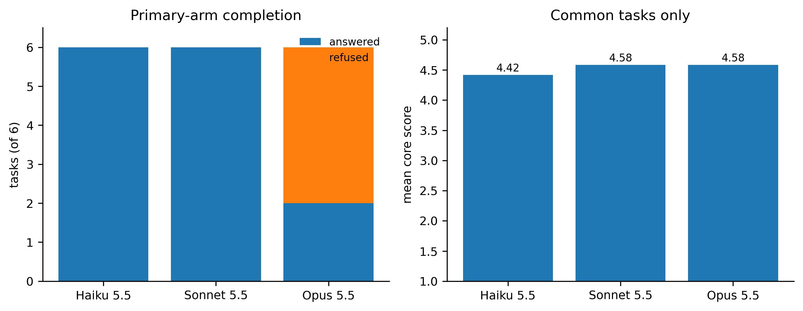

# Scientific evaluation of Claude models on translational cancer biology tasks

**Shu Chen — Postdoctoral Scholar, UCSF**

This is a small, blinded pilot evaluation of Claude models on six tasks drawn from experimental and translational prostate cancer work. The aim is not to produce a broad benchmark score. It is to test a narrower question: can model outputs support real experimental decisions without introducing errors that would waste bench time or distort interpretation?

The tasks use only public data from my companion repository, [`prostate-ai-hypothesis-evaluation`](https://github.com/Shu-Chenzy/prostate-ai-hypothesis-evaluation). No unpublished experimental data are included.

## Tasks

| Task | Capability | Main question |
|---|---|---|
| [T1](review/T1.md) | Evidence grounding | Does the answer separate direct evidence from inference and speculation? |
| [T2](review/T2.md) | Mechanistic / causal reasoning | Does it distinguish association, selection, and causation? |
| [T3](review/T3.md) | Target prioritization | Which candidate should be tested first under fixed time and resource constraints? |
| [T4](review/T4.md) | Experimental design | Is the proposed experiment minimal, interpretable, controlled, and falsifiable? |
| [T5](review/T5.md) | Closed-loop decision-making | Can it move from evidence to a gated experimental plan with stop rules? |
| [T6](review/T6.md) | Quantitative assay design | Can it design a practical assay for a low-abundance cell-surface GPCR? |

## Evaluation design

- Haiku 5.5, Sonnet 5.5, and Opus 5.5 receive the same prompt, public input packet, output schema, and `effort: high`, each in a fresh context.
- Responses are scored blind as Model A/B/C. Labels are reshuffled for every task.
- Six dimensions are scored from 1–5: biological correctness, evidence grounding, causal reasoning, experimental feasibility, falsifiability, and uncertainty calibration.
- Fifteen predefined failure codes capture specific errors such as unsupported mechanism, missing controls, poor prioritization, and incorrect experimental logic.
- Primary-arm refusals are recorded as refusals. They are not silently replaced in the model-level summary.
- A separate fallback arm was run only for refused prompts so those tasks could still be inspected; fallback answers are reported separately from the requested model.

Scoring details: [`scoring/rubric.md`](scoring/rubric.md) and [`scoring/failure_taxonomy.md`](scoring/failure_taxonomy.md).

## Input data

All tasks share [`inputs/public/prostate_public_packet.md`](inputs/public/prostate_public_packet.md), built from public GSE35988 and SU2C/PCF 2019 analyses. The packet contains expression statistics and candidate annotations, but no perturbation, drug-response, organoid, or animal results. When a prompt asks beyond those data, the model must identify what is missing rather than invent evidence.

## Results

### Primary arm

| Model | Answered | Refused | Mean score on answered primary tasks | Mean score on T1–T2* |
|---|---:|---:|---:|---:|
| Haiku 5.5 | 6/6 | 0/6 | 4.14 | 4.42 |
| Sonnet 5.5 | 6/6 | 0/6 | 4.47 | 4.58 |
| Opus 5.5 | 2/6 | 4/6 | 4.58 | 4.58 |

\*T1–T2 are the only tasks answered by all three requested models, so they are the only clean three-model score comparison. I do **not** report a six-task Opus 5.5 mean.



Opus 5.5 answered the two evidence/reasoning tasks and refused T3–T6, which ask for target selection, experimental design, closed-loop planning, or assay design. Each refusal reproduced on two repeat attempts. Details: [`results/refusal_summary.md`](results/refusal_summary.md).

### Fallback arm

For T3–T6, a separate fallback-enabled run served answers from Claude Opus 5 after the Opus 5.5 refusal. Those four responses were scored for qualitative comparison, but they are not counted as Opus 5.5 performance. Their mean core score was 4.29. Raw responses remain in [`outputs/claude-opus-5-5+fallback/`](outputs/claude-opus-5-5+fallback/).

### Main failure modes

Two errors mattered most for wet-lab decision-making:

- **Target prioritization:** on T3 and T5, every scoreable response led with a candidate that did not meet the replication threshold in the supplied data rather than the strongest reproducible signal.
- **Rescue interpretation:** on T4, every scoreable response treated a failed rescue as stronger evidence against on-target causality than I would accept experimentally. A failed rescue can be technically ambiguous.

Evidence grounding was consistently strong on the tasks that directly tested it. The weaker step was deciding what to do with the evidence under experimental constraints.

Across the 18 scored responses (including the clearly labelled fallback arm), answer length did not track score (Spearman rho = 0.03). Stated confidence had a moderate positive association with score (rho = 0.50), but this pilot is too small for inference beyond the observed tasks.

Full results: [`results/analysis.md`](results/analysis.md). Per-response scores and reviewer notes: [`scoring/blind_scores.csv`](scoring/blind_scores.csv). The full analysis, with every table and figure, is in [`notebooks/claude_scientific_eval_analysis.ipynb`](notebooks/claude_scientific_eval_analysis.ipynb).

## How I would use this at the bench

On this task set, the models were useful for organizing evidence, enumerating alternatives, and drafting controls. The main errors appeared at the point of prioritization and interpretation of negative experiments. I would therefore use model output as structured input to an experimental decision, not as the decision itself.

## Limitations

- Six tasks and one scorer; inter-rater reliability is not measured.
- One shared input packet limits task diversity.
- Only one generation per answered task was scored; sampling variability was not measured.
- Opus 5.5 refused four tasks, so only T1–T2 support a direct three-model score comparison.
- The four fallback answers were served by Opus 5 and are supplementary, not Opus 5.5 measurements.
- These tasks test a narrow slice of translational cancer biology and should not be generalized to scientific reasoning as a whole.

## Reproduce

```bash
pip install -r requirements.txt
export ANTHROPIC_API_KEY=sk-ant-...
python scripts/build_packet.py ../prostate-ai-hypothesis-evaluation
python scripts/build_tasks_v1.py
python scripts/run_models.py
python scripts/retry_refusals.py --attempts 2
python scripts/run_models.py --models claude-opus-5-5 --fallback
python scripts/blind_and_build_sheet.py
# score the blinded sheet, then:
python scripts/analyze_blind.py --publish-key
python scripts/build_review_pages.py
```

To re-run the analysis without calling the API, open [`notebooks/claude_scientific_eval_analysis.ipynb`](notebooks/claude_scientific_eval_analysis.ipynb). It reads only committed files and checks its tables against `results/`.

## Repository layout

```text
├── tasks/                  prompts and task-specific scoring anchors
├── inputs/public/          shared public-data packet
├── outputs/<model>/        raw model responses
├── review_blind/           material used for blind scoring
├── review/                 unblinded responses, scores, and notes
├── scoring/                rubric, failure taxonomy, completed scores
├── notebooks/              analysis notebook (reads committed files only)
├── results/                tables, figures, and refusal record
└── scripts/                task generation, model calls, blinding, analysis
```

## Contact

Shu Chen · shu.chen@ucsf.edu · [LinkedIn](https://www.linkedin.com/in/shu-chen-170111323/) · [Google Scholar](https://scholar.google.com/citations?hl=en&user=WkITc2YAAAAJ)
