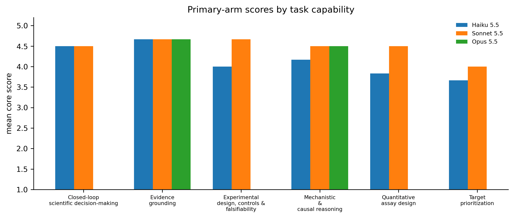
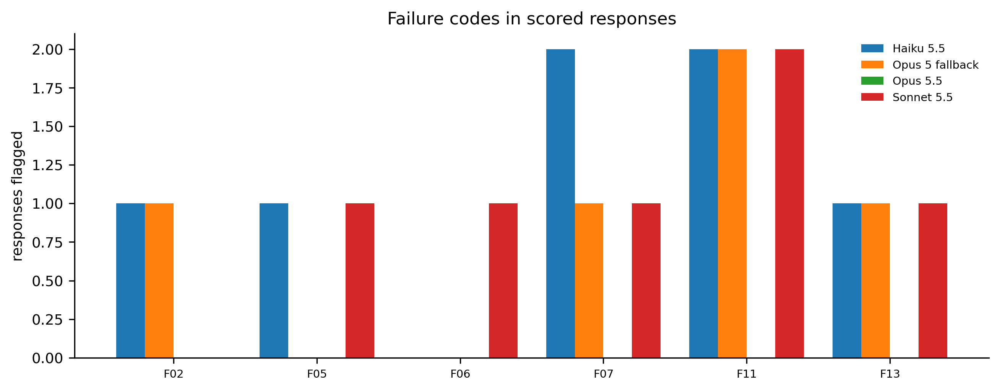

# Results

Six tasks were scored blind using the rubric in `scoring/rubric.md`. The label mapping was revealed only after scoring and failure-code annotation were complete.

## 1. Primary-arm completion

| Model | Answered | Refused |
|---|---:|---:|
| Haiku 5.5 | 6/6 | 0/6 |
| Sonnet 5.5 | 6/6 | 0/6 |
| Opus 5.5 | 2/6 | 4/6 |

Opus 5.5 answered T1–T2 and refused T3–T6. Each refusal reproduced on two additional attempts with the same `bio` refusal category. Because of this, there is no clean six-task Opus 5.5 score.

## 2. Direct three-model comparison

T1 and T2 are the only tasks answered by all three requested models.

| Model | n | Mean core score | Mean words | Mean confidence |
|---|---:|---:|---:|---:|
| Haiku 5.5 | 2 | 4.42 | 1,839 | 47.5% |
| Sonnet 5.5 | 2 | 4.58 | 1,729 | 51.0% |
| Opus 5.5 | 2 | 4.58 | 2,554 | 50.0% |

With only two common tasks, these differences are descriptive only.

## 3. Full primary-arm scores

Haiku and Sonnet answered all six tasks. Their mean scores across the full set were 4.14 and 4.47, respectively. Opus 5.5's mean score of 4.58 applies only to T1–T2.

The capability-level table is in `results/by_capability.csv`; blank Opus cells correspond to primary-arm refusals rather than missing analysis.

## 4. Fallback arm

A separate fallback-enabled run was used only for the four Opus 5.5 refusals so those prompts could still be reviewed. The API served all four from Claude Opus 5. Their mean core score was 4.29.

These responses are reported as **Opus 5 fallback**, not as Opus 5.5 performance. They are stored in `outputs/claude-opus-5-5+fallback/`.

## 5. Failure modes

Across all 18 scored responses, including the clearly labelled fallback arm, 18 failure flags were assigned. Two patterns were most relevant experimentally.

### Target prioritization

F11 (`poor prioritization`) was assigned to every scoreable response on T3 and T5. In each case the answer led with a candidate that did not meet the replication threshold in the provided data instead of the strongest reproducible signal. For a real project, this is the kind of error that can redirect weeks of experimental work.

### Rescue interpretation

F07 (`incorrect experimental logic`) was assigned to every scoreable response on T4. The common issue was treating a failed rescue as decisive evidence against on-target causality. In practice, rescue failure can reflect construct function, expression level, isoform choice, localization, or other technical problems.

## 6. Answer length and confidence

Across the 18 scored responses:

- answer length vs mean score: Spearman rho = 0.03
- stated confidence vs mean score: Spearman rho = 0.50

Longer answers were not better on this task set. Confidence was directionally informative, but the sample is too small to treat either relationship as a general model property.

## 7. Practical interpretation

The models were strongest when organizing the provided evidence and separating observation from interpretation. The more consequential errors appeared when the task required a decision under experimental constraints: which target to test, how to interpret a negative rescue, and when to stop.

For my own use, that supports a simple division of labor: use the model to structure evidence, surface alternatives, and draft controls; keep target prioritization and interpretation of negative experiments with the experimentalist.

## Limitations

- One scorer; no inter-rater reliability measurement.
- Six tasks drawn from one shared public-data packet.
- One scored generation per answered task.
- Opus 5.5 refused four tasks, leaving only two direct three-model comparisons.
- The fallback arm uses Opus 5 and is supplementary.
- The task set is specific to experimental and translational prostate cancer biology.

Raw scores: `scoring/blind_scores.csv`  
Blinding key: `results/blinding_key.csv`  
Refusal record: `results/refusal_summary.md`
